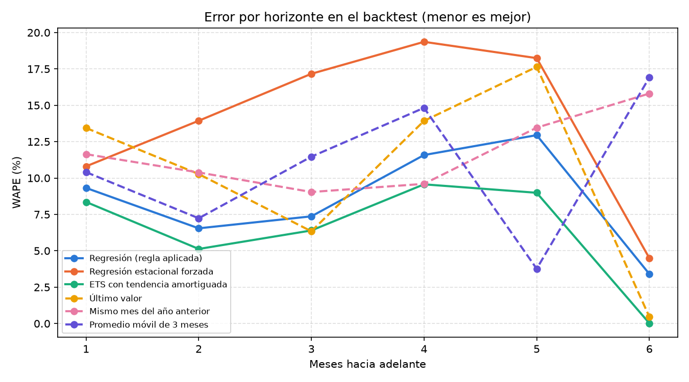
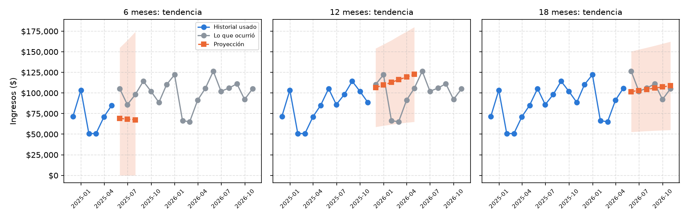

# Evaluación de los modelos de proyección

Generado por `backend/scripts/evaluate_models.py` (semilla 20261108) con
`DatosDePrueba/ventas_fabricadas/ventas_tienda_2_anios.xlsx`: 28,667 ventas, 24 meses
completos, de 2024-11 a 2026-10. Todas
las métricas salen de meses que el modelo no vio. Los datos son fabricados: muestran
que el método funciona, no su desempeño en una tienda real.

## Backtest con origen móvil

Se entrena con los primeros 18 meses y se avanza un mes por vez; en cada origen
se predicen los meses 1 a 6 siguientes. El horizonte 1 tiene 6 orígenes y el 6, uno
solo. Con 24 meses no se pueden validar los meses 7 a 12: son extrapolación sin
validar.

"Regla aplicada" es lo que el sistema hace con ese historial: con 18 a 23 meses, solo
tendencia. "Estacional forzada" ajusta tendencia y 11 meses del calendario aunque el
sistema no la use con ese historial. Con 18 a 23 meses cada mes del calendario tiene
1 o 2 observaciones, así que esta evaluación es débil.

Este backtest motivó la regla actual: la especificación estacional, que antes se
usaba desde 24 meses, perdía contra el mismo mes del año anterior en la mayoría de
los horizontes. Desde entonces la estacionalidad empieza en 36 meses (3 observaciones
por mes del calendario) y con 24 a 35 meses se usa solo la tendencia.

### WAPE (%) por horizonte

| Horizonte | Regresión (regla aplicada) | Regresión estacional forzada | ETS con tendencia amortiguada | Último valor | Mismo mes del año anterior | Promedio móvil de 3 meses |
|---|---|---|---|---|---|---|
| 1 | 9.32 | 10.80 | 8.36 | 13.44 | 11.64 | 10.41 |
| 2 | 6.54 | 13.94 | 5.13 | 10.27 | 10.38 | 7.23 |
| 3 | 7.37 | 17.16 | 6.40 | 6.34 | 9.04 | 11.47 |
| 4 | 11.58 | 19.36 | 9.57 | 13.93 | 9.60 | 14.82 |
| 5 | 12.95 | 18.24 | 8.99 | 17.64 | 13.46 | 3.76 |
| 6 | 3.40 | 4.49 | 0.02 | 0.46 | 15.81 | 16.91 |

### Mejora frente al mejor modelo de referencia

Mejora porcentual del WAPE frente al mejor de los tres modelos simples en cada
horizonte. Un valor negativo significa que la regresión pierde.

| Horizonte | Modelo | WAPE modelo | Mejor referencia | WAPE referencia | Mejora (%) | Gana al mismo mes del año anterior |
|---|---|---|---|---|---|---|
| 1 | Regresión (regla aplicada) | 9.32 | Promedio móvil de 3 meses | 10.41 | 10.43 | sí |
| 1 | Regresión estacional forzada | 10.80 | Promedio móvil de 3 meses | 10.41 | -3.83 | sí |
| 2 | Regresión (regla aplicada) | 6.54 | Promedio móvil de 3 meses | 7.23 | 9.54 | sí |
| 2 | Regresión estacional forzada | 13.94 | Promedio móvil de 3 meses | 7.23 | -92.66 | no |
| 3 | Regresión (regla aplicada) | 7.37 | Último valor | 6.34 | -16.23 | sí |
| 3 | Regresión estacional forzada | 17.16 | Último valor | 6.34 | -170.80 | no |
| 4 | Regresión (regla aplicada) | 11.58 | Mismo mes del año anterior | 9.60 | -20.64 | no |
| 4 | Regresión estacional forzada | 19.36 | Mismo mes del año anterior | 9.60 | -101.67 | no |
| 5 | Regresión (regla aplicada) | 12.95 | Promedio móvil de 3 meses | 3.76 | -243.91 | sí |
| 5 | Regresión estacional forzada | 18.24 | Promedio móvil de 3 meses | 3.76 | -384.52 | no |
| 6 | Regresión (regla aplicada) | 3.40 | Último valor | 0.46 | -641.23 | sí |
| 6 | Regresión estacional forzada | 4.49 | Último valor | 0.46 | -878.19 | sí |

La regla aplicada pierde contra el mismo mes del año anterior en
1 de 6 horizontes; la estacional forzada, en 4 de 6.

### Detalle por modelo y horizonte

| Modelo | Horizonte | n | WAPE | MASE | MAPE | RMSE | R² | Cobertura 95 % |
|---|---|---|---|---|---|---|---|---|
| Regresión (regla aplicada) | 1 | 6 | 9.32 | 0.49 | 9.29 | 13,418.30 | -0.67 | 100.00 |
| Regresión (regla aplicada) | 2 | 5 | 6.54 | 0.33 | 6.95 | 9,723.20 | -1.38 | 100.00 |
| Regresión (regla aplicada) | 3 | 4 | 7.37 | 0.38 | 7.92 | 10,912.66 | -1.42 | 100.00 |
| Regresión (regla aplicada) | 4 | 3 | 11.58 | 0.59 | 12.20 | 13,807.77 | -2.02 | 100.00 |
| Regresión (regla aplicada) | 5 | 2 | 12.95 | 0.63 | 13.17 | 12,996.97 | -2.99 | 100.00 |
| Regresión (regla aplicada) | 6 | 1 | 3.40 | 0.18 | 3.40 | 3,580.65 | — | 100.00 |
| Regresión estacional forzada | 1 | 6 | 10.80 | 0.57 | 11.43 | 15,386.11 | -1.20 | 66.67 |
| Regresión estacional forzada | 2 | 5 | 13.94 | 0.71 | 14.24 | 18,024.89 | -7.17 | 60.00 |
| Regresión estacional forzada | 3 | 4 | 17.16 | 0.88 | 17.60 | 20,744.69 | -7.75 | 50.00 |
| Regresión estacional forzada | 4 | 3 | 19.36 | 0.98 | 19.91 | 23,018.45 | -7.38 | 66.67 |
| Regresión estacional forzada | 5 | 2 | 18.24 | 0.89 | 19.21 | 22,371.90 | -10.83 | 50.00 |
| Regresión estacional forzada | 6 | 1 | 4.49 | 0.23 | 4.49 | 4,725.33 | — | 100.00 |
| ETS con tendencia amortiguada | 1 | 6 | 8.36 | 0.44 | 8.21 | 12,710.26 | -0.50 | 100.00 |
| ETS con tendencia amortiguada | 2 | 5 | 5.13 | 0.26 | 5.44 | 7,879.14 | -0.56 | 100.00 |
| ETS con tendencia amortiguada | 3 | 4 | 6.40 | 0.33 | 6.82 | 8,829.53 | -0.58 | 100.00 |
| ETS con tendencia amortiguada | 4 | 3 | 9.57 | 0.49 | 10.01 | 11,302.75 | -1.02 | 100.00 |
| ETS con tendencia amortiguada | 5 | 2 | 8.99 | 0.44 | 9.26 | 9,511.99 | -1.14 | 100.00 |
| ETS con tendencia amortiguada | 6 | 1 | 0.02 | 0.00 | 0.02 | 22.30 | — | 100.00 |
| Último valor | 1 | 6 | 13.44 | 0.71 | 13.63 | 16,350.29 | -1.48 | — |
| Último valor | 2 | 5 | 10.27 | 0.52 | 10.36 | 12,201.20 | -2.75 | — |
| Último valor | 3 | 4 | 6.34 | 0.32 | 6.38 | 9,115.96 | -0.69 | — |
| Último valor | 4 | 3 | 13.93 | 0.71 | 15.06 | 20,153.82 | -5.43 | — |
| Último valor | 5 | 2 | 17.64 | 0.86 | 17.46 | 17,837.12 | -6.52 | — |
| Último valor | 6 | 1 | 0.46 | 0.02 | 0.46 | 483.07 | — | — |
| Mismo mes del año anterior | 1 | 6 | 11.64 | 0.62 | 11.56 | 13,886.06 | -0.79 | — |
| Mismo mes del año anterior | 2 | 5 | 10.38 | 0.53 | 10.52 | 11,896.44 | -2.56 | — |
| Mismo mes del año anterior | 3 | 4 | 9.04 | 0.46 | 9.19 | 10,559.57 | -1.27 | — |
| Mismo mes del año anterior | 4 | 3 | 9.60 | 0.49 | 9.78 | 11,320.17 | -1.03 | — |
| Mismo mes del año anterior | 5 | 2 | 13.46 | 0.66 | 13.30 | 13,694.97 | -3.43 | — |
| Mismo mes del año anterior | 6 | 1 | 15.81 | 0.82 | 15.81 | 16,623.17 | — | — |
| Promedio móvil de 3 meses | 1 | 6 | 10.41 | 0.55 | 9.90 | 17,314.60 | -1.78 | — |
| Promedio móvil de 3 meses | 2 | 5 | 7.23 | 0.37 | 7.71 | 10,913.41 | -2.00 | — |
| Promedio móvil de 3 meses | 3 | 4 | 11.47 | 0.59 | 11.87 | 13,843.71 | -2.89 | — |
| Promedio móvil de 3 meses | 4 | 3 | 14.82 | 0.75 | 14.79 | 16,852.84 | -3.49 | — |
| Promedio móvil de 3 meses | 5 | 2 | 3.76 | 0.18 | 3.85 | 3,861.67 | 0.65 | — |
| Promedio móvil de 3 meses | 6 | 1 | 16.91 | 0.88 | 16.91 | 17,781.72 | — | — |

MASE se escala con el error del último valor dentro de los 18 meses iniciales:
menor que 1 es mejor que ese modelo ingenuo. R² con 1 a 6 puntos es inestable y se
muestra solo para completar. La cobertura es el porcentaje de meses reales dentro del
intervalo del 95 %; los modelos simples no tienen intervalo.

## Diagnóstico de residuos

Modelo final con los 24 meses: tendencia.

| Prueba | Valor p |
|---|---|
| Ljung–Box, 3 rezagos | 0.3455 |
| Ljung–Box, 6 rezagos | 0.4476 |
| Breusch–Pagan | 0.2701 |

Un valor p menor que 0.05 en Ljung–Box indica autocorrelación en los residuos; en
Breusch–Pagan, varianza no constante.

## Niveles del modelo escalonado

El historial se corta a 6, 12 y 18 meses, se proyecta con la regla del sistema y se
compara con lo que ocurrió después.

| Meses usados | Modelo | Horizonte | Meses comparados | WAPE | MAPE | Cobertura 95 % | WAPE último valor | WAPE mismo mes año anterior |
|---|---|---|---|---|---|---|---|---|
| 6 | tendencia | 3 | 3 | 29.15 | 28.67 | 100.00 | 11.81 | — |
| 12 | tendencia | 6 | 6 | 28.29 | 34.78 | 100.00 | 21.54 | 22.84 |
| 18 | tendencia | 9 | 6 | 7.98 | 7.77 | 100.00 | 6.88 | 11.64 |

## Por categoría

WAPE promedio de los horizontes 1 a 6 en el backtest de cada categoría.

| Categoría | Regla aplicada | Estacional forzada | ETS amortiguado | Mejor referencia | WAPE referencia | Mejora regla (%) |
|---|---|---|---|---|---|---|
| Abarrotes | 7.68 | 15.33 | 7.08 | Promedio móvil de 3 meses | 8.99 | 14.55 |
| Bebidas | 13.05 | 13.22 | 11.29 | Mismo mes del año anterior | 14.24 | 8.35 |
| Cuidado Personal | 8.54 | 12.80 | 8.09 | Promedio móvil de 3 meses | 13.54 | 36.90 |
| Limpieza | 18.18 | 23.81 | 16.11 | Promedio móvil de 3 meses | 7.17 | -153.65 |
| Lácteos | 6.10 | 15.99 | 5.44 | Promedio móvil de 3 meses | 8.20 | 25.63 |
